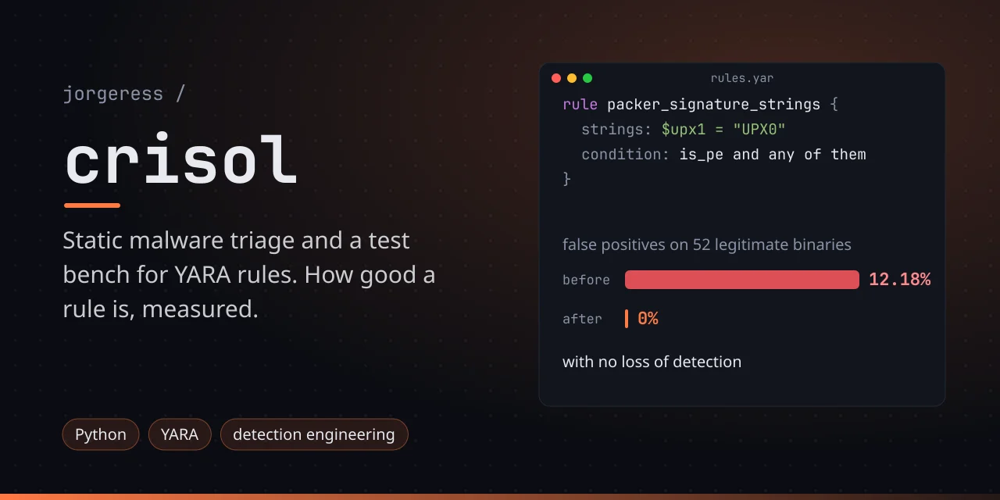
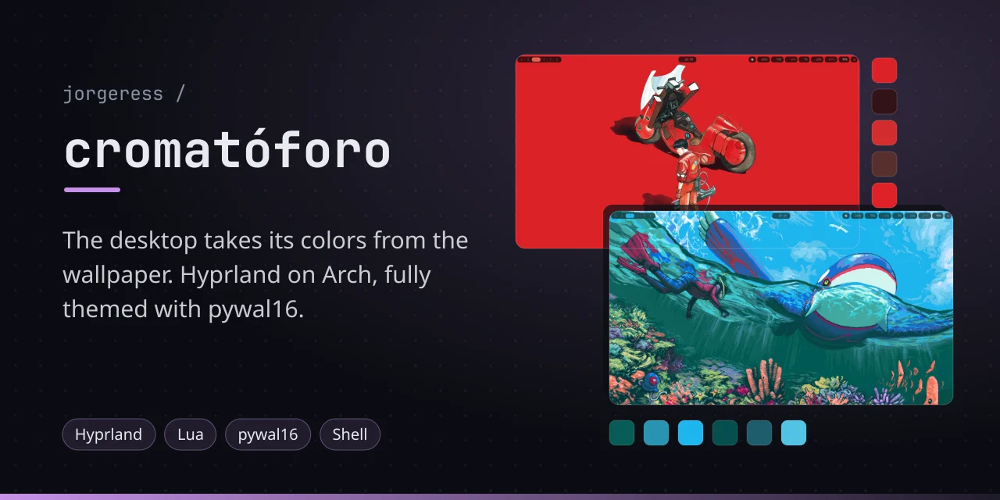
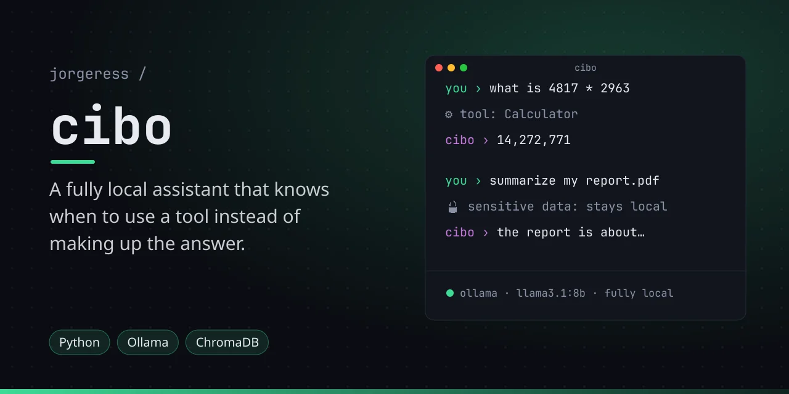
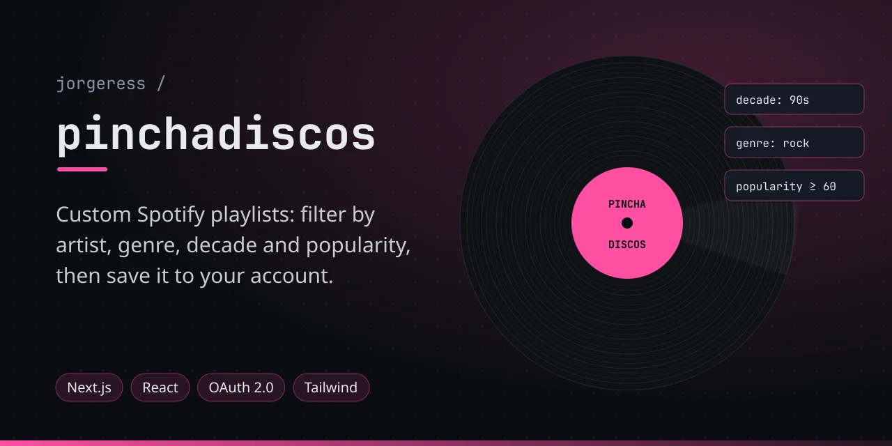
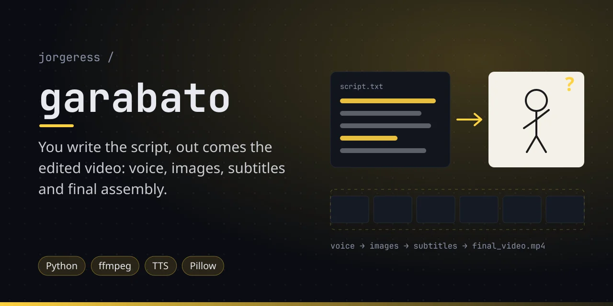
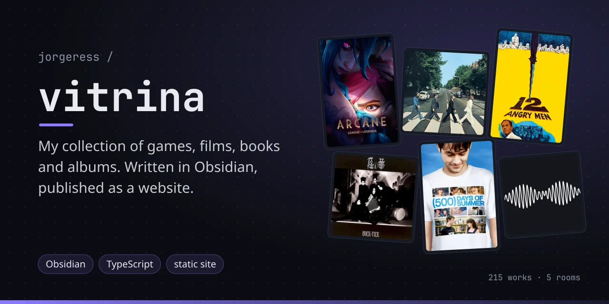

  
  
  

Ciberseguridad, Linux y ML.

### Con lo que trabajo

  

### Proyectos

  
  
  
  
  
  

<b>Crisol</b>: motor de triaje estático de malware y banco de pruebas para reglas YARA

 

Cualquiera puede lanzar `yara reglas.yar muestra.exe`. Lo que distingue a un analista es saber cuánto vale esa regla: cuántos falsos positivos suelta contra software legítimo y qué detecta de verdad. Aquí eso es un número reproducible. El harness midió un 12,18 % de falsos positivos sobre 52 binarios firmados y legítimos, y guió el rediseño regla a regla hasta dejarlo en 0 % sin perder detección. Cada cambio está justificado con datos, no con intuición.

<b>Cromatóforo</b>: un escritorio de Arch donde todo el color sale del wallpaper

 

Cambias el fondo y la barra, el lanzador, el terminal, el prompt, las notificaciones, el editor, el navegador, Steam, Spotify y las aplicaciones GTK y Qt adoptan la paleta en la misma pasada. Diecinueve consumidores colgando de un único origen de verdad, cada uno con su plantilla: para cambiar cómo se mapea un color se toca la plantilla, nunca el config del programa final.

Lo interesante no es que quede bonito, es lo que no encaja en el modelo. `qt6ct` vigila su fichero de configuración y no el esquema al que ese fichero apunta, así que regenerar la paleta no repinta nada y hay que hacerle `touch` para despertarlo. Steam solo lee su CSS al arrancar, y el script no lo reinicia a propósito: te cerraría el juego en mitad de una partida. Todo eso está documentado, trampas incluidas.

<b>CIBO</b>: asistente de IA que corre entero en local sobre Ollama

 

Sabe cuándo tirar de una calculadora real en vez de inventarse los números, ejecuta código Python en un subproceso aislado y lleva una capa que impide que los datos sensibles salgan del equipo. Lo empecé para entender cómo funciona un LLM por dentro en lugar de quedarme en usarlo.

<b>Pinchadiscos</b>: generador de playlists de Spotify en Next.js

 

Filtras por artista, género, década y popularidad, revisas el resultado en el navegador y lo guardas en tu cuenta real. OAuth 2.0 con refresco automático de token y el intercambio pasando por rutas de servidor, para que el client secret no acabe nunca en el navegador.

<b>Garabato</b>: de un guion en texto plano a un vídeo montado

 

Voz, imágenes, subtítulos y ensamblado final. Lo monté porque grabar la narración y buscar una imagen por frase es lo que convierte un vídeo de ocho minutos en un día entero de trabajo. Los guiones siguen unas reglas y criterios fijados de antemano, y el pipeline hace el resto del vídeo sin que yo toque nada. Cada paso es idempotente: puedes cortar por la mitad y retomar.

<b>Vitrina</b>: mi colección de juegos, películas, libros y discos, de Obsidian a la web

 

Cada obra es una ficha en Markdown dentro de Obsidian, y se publica como web estática en [jorgeress.github.io/vitrina](https://jorgeress.github.io/vitrina/). Está explicado cómo montarte la tuya.

También **[PokeGAN](https://github.com/jorgeress/pokegan)**, una DCGAN entrenada desde cero durante 10.000 épocas para generar sprites de Pokémon.

Ahora mismo estoy con una app que todavía es secreto.

 

<picture>
  <source media="(prefers-color-scheme: dark)" srcset="https://raw.githubusercontent.com/jorgeress/jorgeress/output/serpiente-oscura.svg">
  
</picture>
